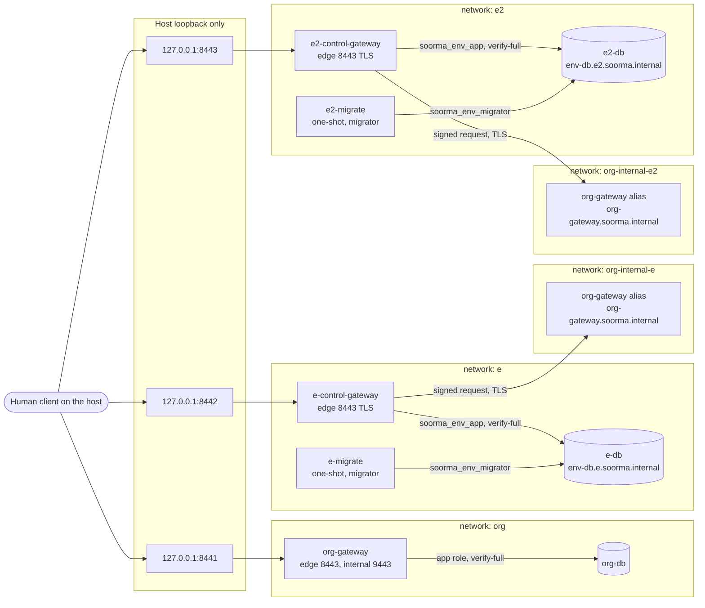

# Deployment Architecture: U4 `env-human-access`

**Unit**: U4 `env-human-access` (soorma-core#7)
**Design**: [infrastructure-design.md](infrastructure-design.md)
**Where**: `deploy/local/compose.yaml` (FSL-1.1-ALv2), run with `pnpm stack:init`,
`pnpm stack:up`, and `pnpm stack:down`. It extends U2's stack
([../../org-identity/infrastructure-design/deployment-architecture.md](../../org-identity/infrastructure-design/deployment-architecture.md))

## Decisions Index

| # | Decision |
|---|---|
| Q1 A | One `compose.yaml`; each environment's services, volumes, networks, and secrets written out in full; anchors for the shared shape only |
| Q2 A | S1 accepts `publicKeys` per environment; **a `kid` in two environments, or twice in one, refuses start-up** (the user's addition, I1) |
| Q3 A | `## Operations` in each service's README; S1's rotation says **"wait at least 5 minutes"** |
| P-01 | Per environment: `{env}-secrets-init`, `{env}-db`, `{env}-migrate`, `{env}-control-gateway`. **S2 does not depend on `org-gateway`** |
| P-02, P-03 | Secrets as mounted files only, through `{env}-secrets-init`. The caller **public** key is the one value that crosses to the organization level |
| P-04 | `soorma_env`, `soorma_env_migrator`, `soorma_env_app` in every instance; **column-level privileges in `0001_init.sql`** |
| P-05 | Networks `{env}` and `org-internal-{env}`; edges at `127.0.0.1:8442` (E) and `127.0.0.1:8443` (E2) |
| P-06 | `tenancy.yaml`: a `controlGateway` part per environment |
| P-07 | Certificates for `control-gateway.{env}.soorma.internal` and `env-db.{env}.soorma.internal` |
| P-08 | S2's events and five rules in `alerts.yaml`; dashboard panels |
| P-09, as changed | The S1-stopped demonstration, in two cases |
| P-10 | S2 `mem_limit: 256m`; U2's hardening |
| P-11 | E's minting-key rotation in the operations notes |

---

## The Local Stack After U4



### Text alternative

```text
Host 127.0.0.1:8441  ->  org-gateway:8443 (S1 edge, TLS)
Host 127.0.0.1:8442  ->  e-control-gateway:8443 (E's S2 edge, TLS)
Host 127.0.0.1:8443  ->  e2-control-gateway:8443 (E2's S2 edge, TLS)

[network org]              org-gateway -> org-db:5432 (soorma_org_app, verify-full)
[network e]                e-control-gateway -> e-db:5432 (soorma_env_app, verify-full)
[network e]                e-migrate -> e-db:5432 (soorma_env_migrator), then exits
[network e2]               e2-control-gateway -> e2-db:5432 (soorma_env_app, verify-full)
[network e2]               e2-migrate -> e2-db:5432 (soorma_env_migrator), then exits
[network org-internal-e]   e-control-gateway -> org-gateway:9443 (signed, TLS)
[network org-internal-e2]  e2-control-gateway -> org-gateway:9443 (signed, TLS)

No network holds services of two environments. e-db and e2-db are published nowhere.
Health listeners: 127.0.0.1:8080 inside each container, on no network.
Secrets copiers (org-, e-, e2-secrets-init): network_mode none.
```

## Start-Up Order

| # | Service | Waits for | Then |
|---|---|---|---|
| 0 | (host) `pnpm stack:init`, `pnpm stack:certs` | — | Every secret, including E's and E2's, and the derived caller public keys exist. Nothing is overwritten |
| 1 | `org-secrets-init`, `e-secrets-init`, `e2-secrets-init` | — | Each copies **only its own level's** secrets into its volume, then exits 0 |
| 2 | `org-db`, `e-db`, `e2-db` | Their own secrets-init completed | Healthy by `pg_isready` |
| 3 | `org-migrate`, `e-migrate`, `e2-migrate` | Their own store healthy | Apply migrations under that store's advisory lock, then **exit 0** |
| 4 | `org-gateway` | `org-migrate` completed successfully | As U2. **It refuses to start on a duplicate caller `kid`** (Q2 addition) |
| 4 | `e-control-gateway`, `e2-control-gateway` | Their own migrate completed successfully. **Not `org-gateway`** | Steps 1 to 4 of logical-components.md §1 (configuration, key ring, pool, first grant); start the verify-key fetch **without blocking**; listen. Healthy on a 204 from `127.0.0.1:8080` |

A configuration, key, or first-grant error stops that environment's S2 (D-EHA-28). The other
environment is unaffected. A changed, applied migration fails `{env}-migrate`, so that S2 never
starts.

## Volumes and Mounts

| Container | Mounts (each secret read-only, at `/run/secrets`, from its own level's volume subpath) |
|---|---|
| `e-secrets-init` | E's `file:` secrets only, and `stack-ca-cert`; volume `e-secrets` (writable) |
| `e-db` | Subpath `db`: `e-db-tls`, `e-db-superuser-password`, `e-db-app-password`, `e-db-migrator-password`, `stack-ca-cert`. Volume `e-db-data` |
| `e-migrate` | Subpath `migrate`: `e-db-migrator-password`, `stack-ca-cert`; `tenancy.yaml` |
| `e-control-gateway` | Subpath `control-gateway`: `e-control-gateway-tls`, `e-db-app-password`, `e-signing-key-1`, `e-caller-key`, `e-log-pseudonym-key`, `stack-ca-cert`; `tenancy.yaml`; `tmpfs` `/tmp` |
| `org-gateway` (changed) | Its existing secrets, **plus `e-caller-public-key` and `e2-caller-public-key`**, through `org-secrets-init` |
| E2's containers | The same, with `e2-` |

**No E secret is mounted into any E2 or organization-level container**, apart from the derived
public key, and no E2 or organization-level secret into any E container. The Compose-model test
asserts it (infrastructure-design.md §3).

## When S1 Is Stopped

These are the two cases of infrastructure-design.md §11, scripted in
`deploy/local/scripts/s1-outage.ts`:

| | Case 1: S1 stops under a running S2 | Case 2: S2 starts while S1 is stopped |
|---|---|---|
| Verify keys at S2 | **Kept** (a failed fetch keeps the keys held) | **None loaded** |
| Issuance | 503, `Retry-After: 5` (its `signInStatus` call fails) | 503, `Retry-After: 5` (no keys; NP-EHA-03) |
| Renewal, `grantToHuman` | 503, `Retry-After: 5` | 503, `Retry-After: 5` |
| Ending | Succeeds | Succeeds, including a credential issued before the restart |
| O1 to O4 on a presented credential | As with S1 running | As with S1 running: E's key ring is from configuration |
| After `start org-gateway` | **Recovers as soon as S1 answers** | **Recovers on the next fetch** (the scheduled refresh, or an issuance's on-demand fetch, within the 30-second limit) |

## How U5 to U7 Extend It

These follow [../../shared-infrastructure.md](../../shared-infrastructure.md), as updated by U4:
- **U5** adds no deployable. Its tables join `env-store`'s migration sequence, with their
  privileges granted in the same way (column-level where a row changes).
- **U6** adds `{env}-data-gateway`, and **U7** adds `{env}-event-ingest`:
  - each on network `{env}`, with its own subpath of `{env}-secrets`;
  - **on no `org-internal-*` network** (M1-NFR-08);
  - each with an edge on the next loopback ports: 8444 and up, assigned by each unit's
    Infrastructure Design and recorded in shared-infrastructure.md.
- Each new secret is named in that service's part of `tenancy.yaml`, generated by
  `stack:init`, and listed on its own environment's `{env}-secrets-init` only.
