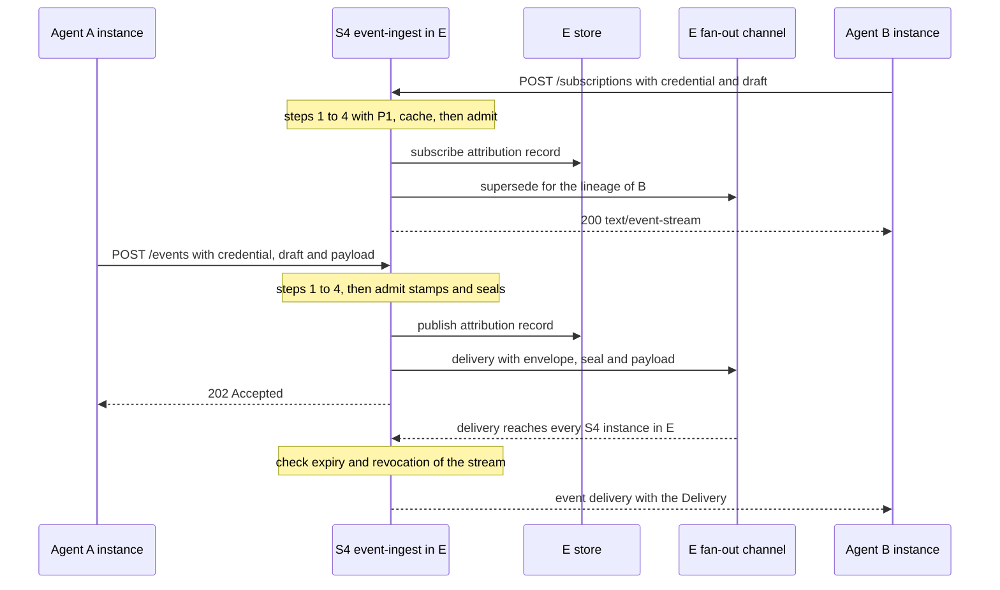

# Business Logic Model: U7 `event-transport`

**Unit**: U7 `event-transport` (soorma-core#10). S4 `event-ingest`, environment E, data face
**Rules**: [business-rules.md](business-rules.md). **Entities**: [domain-entities.md](domain-entities.md)

Symbols: **B** `PROPAGATION_BOUND_MS` (60 s); **L** the agent credential's lifetime (15 min);
**R** the stream's check interval and **P** the Delivery payload bound (NFR Requirements).

---

## 1. Where U7 Sits

*Text alternative*: B subscribes; S4 runs steps 1 to 4 and `admit`, writes the subscribe record,
sends a supersede message for B's lineage on E's channel, and answers `200` with an event
stream. A publishes; S4 runs steps 1 to 4 and `admit` (which stamps and seals), writes the
publish record, puts the Delivery on E's channel, and answers `202`. The channel brings the
Delivery to every S4 instance in E; each checks every open stream's expiry and revocation, then
writes a `delivery` event to it.

S4 never calls the organization level, S2, or S3. Its only dependencies on a request are E's
store (revocation, agent facts, the record) and E's channel.

---

## 2. `publish` (`POST /events`)

1. Throttle slot, or `unavailable`
2. **Step 1**: body over publish's limit: `payload_too_large`
3. **Steps 2 to 4**: `checkAgentRequest(rawHeaders, { verify, revocation })`: one `soorma_ac_`;
   verified with E's agent verify halves; expiry; O4; O3 through the cache at both granularities
4. **`admit`** with the Body Form `{ draft member: draft, members: { payload, bounded by P } }`,
   required `{event:publish}`: step 5 (body object, `draft` object, version); step 6 (schema
   with precedence, then the payload bound); 7 (forwarded context); 8 (depth); 9 (agent facts,
   origin with O12, authority); 10 (envelope bound, stamp, seal)
5. **The record**, one transaction: read A's sponsor from the registration; P7 writes `publish`
   with the agent actor and envelope facts. Failure: `unavailable` (GAP-ET-001 work-around)
6. **The hand-off**: a `delivery` Channel Message with `{ envelope, seal, payload }`. Failure:
   `unavailable` (the record stands)
7. `202 Accepted`, no body

## 3. `subscribe` (`POST /subscriptions`)

1. to 3. As publish, with subscribe's step-1 limit
4. **`admit`** with the Body Form `{ draft member: draft }`, required `{event:subscribe}`
5. **The open-stream cap**: this instance's open streams, not counting one of the same lineage
   here, at the cap: `unavailable`
6. **The record**: `subscribe`, as publish's
7. **Register** the stream (lineage `cid`, the credential's `exp`, an empty send buffer), then
   **supersede**: end this instance's earlier stream of the `cid`, if any, and send a
   `supersede` message on E's channel
8. `200`, `text/event-stream`; heartbeats; deliveries until the stream ends

## 4. A Stream's Life, Worked

B subscribes at t = 0 with a credential whose `exp` is 15:00. R = 5 s for illustration.

| Time | Event | Stream |
|---|---|---|
| 0:00 | Opened; the cache holds `not_revoked` for B's `cid`, read at 0:00 | Open |
| 3:10 | A publishes; before writing the Delivery, S4 checks B's stream: not expired, cache `not_revoked` (age 3:10 > B, so the cache re-reads: `not_revoked`) | `delivery` written |
| 4:00 | B's lineage revoked (test-only seeding) | Open: the cache entry read at 3:10 is younger than B until 4:10 |
| 4:05 | A publishes; the check is a cache hit, `not_revoked` (read at 3:10) | `delivery` written: inside the bound |
| 4:10 | The cache entry reaches B; the next check re-reads | — |
| by 4:15 | The sweep (every R) checks: re-read, `credential_revoked` | `end` `credential_refused`; closed |
| | **No Delivery after 4:00 + B = 5:00 can reach B's stream; here it ended at 4:15** | |

**The same stream through a store outage** (no revocation): the store goes down at 6:00, the
cache entry was read at 5:58. Deliveries cannot happen (no publish can write its record:
GAP-ET-001), but the stream stays open; at 6:58 the entry reaches B, the sweep cannot re-read,
and the stream ends `unavailable` by 7:03 (within R).

**Expiry**: with no renewal, the stream ends at 15:00 exactly with `credential_expired`.

**Renewal and supersede**: B renews at 13:00 (same `cid`, new `exp` 28:00) and subscribes again;
the new stream is registered, then the old one ends `superseded`. A publish accepted between the
two steps reaches at least the new stream.

## 5. Superseding Across Instances, Worked

E runs two S4 instances, X and Y. B's lineage `c1` has a stream on X (opened at 10:00:00, id x7).

1. B subscribes again; the request lands on Y. Y registers stream y3 (opened 10:12:30), then
   sends `supersede { cid: c1, order: (10:12:30, y3) }` on E's channel
2. X receives it: its stream x7 of `c1` is ordered before (10:12:30, y3), so x7 ends with `end`
   `superseded`
3. Y also receives its own message and ignores it: it holds no earlier stream of `c1`

**Race**: B subscribes twice at once, landing on X (x8) and Y (y4). Each sends a `supersede`.
Each instance ends its stream if it is ordered before the other's: exactly one of x8 and y4
survives.

**Lost message**: X misses Y's `supersede`. x7 stays open, and both streams receive each
Delivery until x7's credential `exp` (at most L after it was presented), when x7 ends
`credential_expired`.

## 6. *Done When* 3, 4, 6, 7 by Raw Calls (D-ET-34)

In `e2e/agent-registration.test.ts`, after TC-AC-093, which leaves A's and B's agent credentials
(instances `a-1`, `b-1`) from done when 2. Raw HTTPS through a U7 helper module; no SDK.

| *Done when* | Calls | Observed |
|---|---|---|
| **3** (TC-ET-001) | B: `POST /subscriptions` `{ draft }` (`8446`); A: `POST /events` `{ draft, payload }` | B's stream yields one `delivery`; its payload equals A's |
| **4** (TC-ET-002) | Read that Delivery's envelope; read the `publish` record | `scope` E; `originMode` `autonomous`; `actorChain` `[{ agent: A, instance: a-1 }]`; no `reBroadening`; A's draft carried none of them. The record: actor A, sponsor H, chain `[A]`, origin `autonomous` |
| **6** (TC-ET-006, D-ET-08) | H: an E2 environment credential, `agent:register` in E2, A registered in E2, a secret, an E2 bootstrap; A's publish to E with the E2 credential; A's E credential to E2's S4 (`8447`) | Both `401` `credential_refused`; B's stream receives nothing |
| **7** (TC-ET-007) | Six publishes, each draft setting one of `envelopeVersion`, `scope`, `originMode`, `delegatingPrincipal`, `actorChain`, `reBroadening` | Each `400` `stamped_field_set` naming the field; B's stream receives nothing |

B's stream opens in the first test and is read in each. Done when 5 (a trace emitted) is
soorma-sdk's; S4 carries `traceparent` as A asserted it (TC-ET-003).

## 7. US-09: B Subscribes Forwarding A's Envelope (TC-ET-005)

A's standing set: `{event:publish}`. B's: `{event:subscribe}`, and **B declares `event:subscribe`
for re-broadening**. B received A's Delivery (chain `[A]`, `autonomous`).

1. B: `POST /subscriptions` `{ draft: { clientContractVersion, traceContext, inbound: { envelope,
   seal } } }`
2. Steps 1 to 4 pass. `admit`: the seal verifies with E's ring, scope E (step 7); depth 2 (step
   8); facts for B and A in one read; origin `autonomous`, propagated (step 9); authority:
   `standing(B) ∩ standing(A)` lacks `event:subscribe`, B's declaration recovers it at B's hop:
   allowed, **load-bearing**
3. The record: `subscribe`, chain `[A, B]`, origin `autonomous`, `loadBearing` true, **`hop` 1**
   (the chain's last index)
4. The stream opens. B is never given that envelope (D-ET-02); the record holds it

## 8. Each Refusal (TC-ET Inception Specs)

| TC | Request | Step | Result |
|---|---|---|---|
| TC-ET-006 | Publish to E with an E2 agent credential | 4 (O4) | `credential_refused` |
| TC-ET-007 | A draft setting a stamped field | 6 | `stamped_field_set` |
| TC-ET-008 | A draft with `originMode` `autonomous` | 6 | `stamped_field_set` (GAP-INT-007) |
| TC-ET-009 | C, no autonomy declared, no forwarded context, publish and subscribe | 9 (O12) | `forbidden` |
| TC-ET-010 | B publishes (no `event:publish`) | 9 | `forbidden` |
| TC-ET-011 | A subscribes (no `event:subscribe`) | 9 | `forbidden`; no stream |
| TC-ET-012 | H's `soorma_ec_`, then `soorma_si_` | 2 | `credential_refused`, by kind |
| TC-ET-013 | A's credential beside a `Soorma-Delegation` value | 2 | `credential_refused` |
| TC-ET-014 | A's lineage revoked, then publish after B | 4 (O3) | `credential_refused` |
| TC-ET-019 | Forwarding an envelope whose chain is at 32 | 8 | `chain_too_deep` |
| TC-ET-021 | A malformed credential with a header claiming prior validation | 2 or 3 | `credential_refused`; the header ignored |
| TC-ET-024 | A body violating the schema | 5 or 6 | The contract's error model, before any authority |
| — | A publish without `payload`; with an extra member | 6 | `malformed_request`; `unknown_field` |
| — | A payload over P | 6 | `payload_too_large` |
| — | The store down, a well-formed E credential, cache cold | 4 | `unavailable`; with the cache warm, the record's write: `unavailable` (GAP-ET-001) |
| — | The store down, an expired or E2 credential | 3, 4 | `credential_expired`, `credential_refused`: never `unavailable` (BR-CK-05) |

Stream-side cases: TC-ET-015 (an E2 subscriber receives nothing), 016 (`end`
`credential_expired` at `exp`), 017 (no Delivery after revocation + B; `end`
`credential_refused`), 018 (an event published before the subscribe is never received), 022
(S1 stopped: publish, subscribe, and delivery work), 023 (`x-future` survives forwarding).
