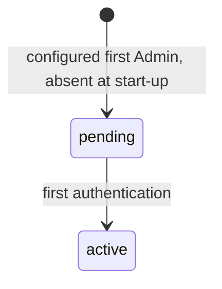
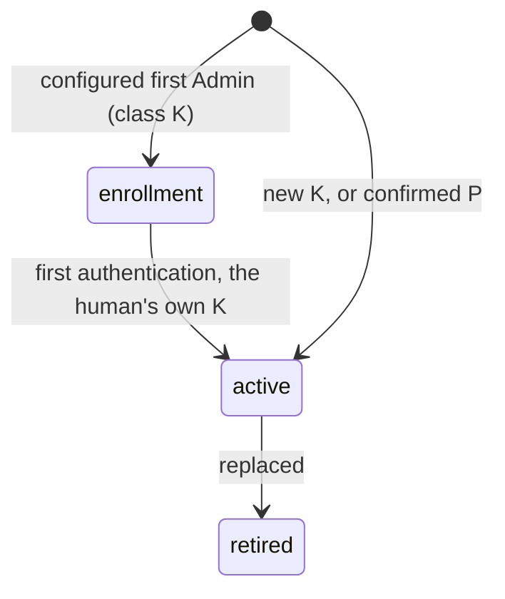
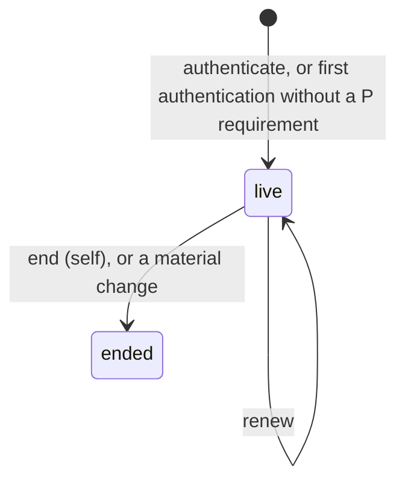

# Business Logic Model: U2 `org-identity`

**Unit**: U2 `org-identity` (soorma-core#5). Control face, organization level
**Rules**: [business-rules.md](business-rules.md). **Entities**: [domain-entities.md](domain-entities.md)

Module names are the Application Design's: P1 `perimeter`, P6 `identity-resolution`, P8
`abuse-bound`, P9 `config`, P10 `org-identity`.

---

## 1. Check Order at S1

U1's check order (BR-ERR-07) applied to S1. A request is refused with the first check it
fails.

**Unauthenticated operations** (`firstAuthenticate`, `authenticate`, `changeMaterial`):

| # | Check | Refusal |
|---|---|---|
| 1 | Body size | `payload_too_large` |
| 2 | No credential is presented: an `Authorization` or `Soorma-Delegation` header is refused, whatever it holds | `malformed_request` (400), with `errors[]` naming the header (BR-RF-06) |
| 3 | Contract version (`Soorma-Contract-Version`) | `unsupported_contract_version` |
| 4 | Schema: closed body, identifier patterns, raw lengths | `malformed_request` |
| 5 | Abuse bound: `P8.admit(presented reference)` | `too_many_attempts` |
| 6 | Material verification through P6, against the principal's state (decoy verifier if absent). The counter is updated on the response path; a Failed Attempt record is written off it (BR-RF-03) | `authentication_failed`, counted |
| 7 | **`authenticate` only**: the second-factor requirement, after K verified | `second_factor_enrollment_required` |
| 8 | New K policy (BR-K: `firstAuthenticate`, `replaceSecret`), or P confirmation (`confirmSecondFactor`) | `secret_rejected`; `second_factor_not_confirmed` |
| 9 | The state change, atomically | — |

Step 2 is defence in depth: these operations accept no credential (BR-CR-08), so a presented
one is a client error and is refused rather than ignored. **It is a 400, not U1's
`credential_refused`**: a 401 must carry `WWW-Authenticate: Bearer` (BR-ERR-06), and no
bearer credential can succeed here (D-OI-13, D-OI-26).

Step 7 applies to `authenticate` alone. `firstAuthenticate` reports the requirement in a 200
(D-OI-23). `changeMaterial` never applies it, so it stays usable for enrolling P (BR-P-03,
BR-P-10).

**Sign-in-bearing operations** (`renewSignIn`, `endSignIn`):

| # | Check | Refusal |
|---|---|---|
| 1 | Body size | `payload_too_large` |
| 2 | Exactly one `Authorization: Bearer soorma_si_…`; no `Soorma-Delegation` | `credential_refused` |
| 3 | Verifies with the organization's material (O2); then expiry | `credential_refused`; then `credential_expired` |
| 4 | Sign-in record `live`; principal `active` (O3) | `credential_refused` |
| 5 | Contract version | `unsupported_contract_version` |
| 6 | Renewal only: the P requirement (BR-SI-05) | `second_factor_enrollment_required` |
| 7 | The operation | — |

---

## 2. Flows

### 2.1 Start-up: configuration and the first Admin (US-01)

```text
P9.loadOrganization(configuration)
  any error ............................................ stop start-up (BR-CFG-08)
for each environment E in the organization's part:
  H := E's first Admin identifier
  if P10.principal(O, H) exists (pending or active):
      if material configured for H: log "ignored for existing principal O/H" (no material)
      continue                                           (BR-CFG-04)
  if no material configured for H ...................... stop start-up (BR-CFG-03)
  P10.ensureFirstAdmin(O, H, material, registeredBy = E)  atomic, at most once (BR-CFG-05)
      -> principal (O, H): pending
      -> material record: class K, state enrollment, verifier = one-way(material)
discard the material's plain form (BR-CFG-09)
start the edge listener and the internal listener
```

### 2.2 First authentication (US-02)

```text
checks 1 to 5 (section 1)
P6.resolve(enrollment, (O, H), material)
  principal absent, not pending, no enrollment record, or no match
      -> P8.recordFailure (on the response path, the same for any reference)
      -> authentication_failed
      -> after the response: a Failed Attempt record if the principal exists (BR-RF-03)
BR-K(newSecret)            fails -> secret_rejected (nothing consumed, not counted)
atomically:
  enrollment record -> active, verifier = one-way(NFKC(newSecret)), established by H
  principal -> active, activatedAt = now
P required (organization setting)?
  yes -> 200 { principal, state: active, secondFactorEnrollmentRequired: true }
  no  -> issue sign-in { classes: [K] } -> 200 { principal, state: active, signIn }
```

### 2.3 Authenticate (US-02)

```text
checks 1 to 5
P6.resolve(K, (O, H), secret)                       fail -> authentication_failed (counted)
P active?
  yes: P6.resolve(P, (O, H), secondFactor)          missing or fail -> authentication_failed (counted)
  no:  secondFactor present                         -> authentication_failed (counted)
       P required by the organization               -> second_factor_enrollment_required
issue sign-in { classes: [K] or [K, P] }; write the sign-in record -> 200 { signIn }
```

### 2.4 Renew and end a sign-in (US-12)

```text
renewSignIn: checks 1 to 6 (sign-in-bearing)
  expiry := min(now + lifetime, authenticatedAt + absolute maximum)
  new token for the same sign-in id; record.expiresAt := expiry -> 200 { signIn }

endSignIn: checks 1 to 5
  record.state := ended, endedAt := now, endedBy := self -> 204
  every token of the sign-in is refused afterwards (O3)
```

### 2.5 Change K (US-12)

```text
checks 1 to 5
verify current material: K, and P if P is active    fail -> authentication_failed (counted)
BR-K(newSecret), including "not equal to the current K"   fail -> secret_rejected
atomically:
  current K -> retired (verifier destroyed); new K -> active, established by H
  remove any Pending P Enrollment
  every live sign-in of H -> ended, endedBy = materialChange
-> 200 { type: replaceSecret, retired: [K], signInsEnded: n }
```

### 2.6 Enroll or replace P (US-02, US-12; M1-TECH-07)

```text
begin:   checks 1 to 5; verify current material (K, and P if active)
         authenticatorType accepted?                 no -> malformed_request
         replace any Pending P Enrollment with a new one
         -> 200 { type: beginSecondFactor, enrollment: { id, expiresAt, setup } }

confirm: checks 1 to 5; verify current material (K, and the old P if active)
         enrollment id is H's, unexpired, and proof verifies?
                                                     no -> second_factor_not_confirmed
         atomically:
           new P -> active, established by H; old P (if any) -> retired
           remove the Pending P Enrollment
           every live sign-in of H -> ended, endedBy = materialChange
         -> 200 { type: confirmSecondFactor, retired: [P] or [], signInsEnded: n }
```

Where the organization requires P, these two calls need **K only** (P is not yet `active`),
and no sign-in. That is how a human whom the requirement would block enrolls P (BR-P-03).

### 2.7 Internal interface (consumed by U4)

```text
internal listener; caller presents E's configured credential
  absent or fails verification against E's caller material -> refused
verifyOnlyMaterial -> the current verify-only keys
principalExists(O, H) -> yes | no
signInStatus(id) -> live | ended | unknown
```

---

## 3. State Machines

### Human Principal



Text: `(none) --[configured, absent]--> pending --[first authentication]--> active`. No M1
transition leaves `active`. No transition deletes the principal.

### Human Authentication Material



Text: `enrollment --[first authentication]--> active --[replaced]--> retired`, and a new K
or a confirmed P starts at `active`. A retired record keeps its metadata and loses its
verifier.

### Organization Sign-In



Text: `(none) --[issued]--> live --[renew]--> live --[end, or material change]--> ended`.
Expiry is a time, not a state. An expired, live sign-in is refused as expired.

---

## 4. Journey Coverage

| Story | Flows | Done when |
|---|---|---|
| US-01 Deployer configures | 2.1 | 1 (ID §1 trace, steps 1 and 2: the organization half) |
| US-02 First Admin activates and signs in | 2.2, 2.3, 2.6 | 1 (step 3) |
| US-03 Environment credential (contributes) | 2.7: verify-only material and `signInStatus` | 1 (step 4, built by U4) |
| US-12 Logout and material change | 2.4, 2.5, 2.6 | — (SECURITY-12) |
