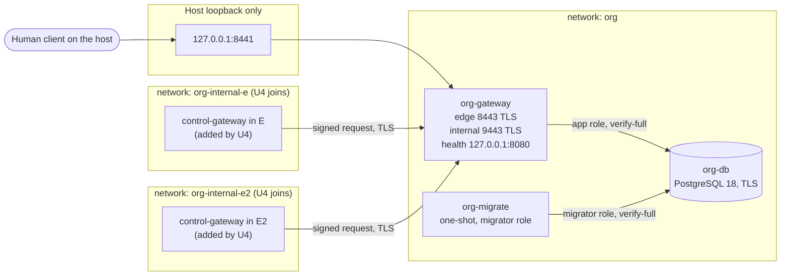

# Deployment Architecture: U2 `org-identity`

**Unit**: U2 `org-identity` (soorma-core#5)
**Design**: [infrastructure-design.md](infrastructure-design.md)
**Where**: `deploy/local/compose.yaml` (FSL-1.1-ALv2, D-ID-OI-08), run with `pnpm stack:up`
and `pnpm stack:down`

## Decisions Index

| # | Decision |
|---|---|
| Q1 A | Docker Compose; a container per deployable; every image pinned by digest |
| Q2 A | Distroless Node 26 `nonroot`; healthcheck through a Node script |
| Q3 A | TLS everywhere from a local CA with name constraints; its key kept in `.secrets/` for U4 to U7 |
| Q4 B | Encryption at rest: not applicable in M1, by the user's decision |
| Q5 A | `tenancy.yaml` plus Compose secret files, generated by `pnpm stack:init` |
| Q6 A | Neutral monitoring files with JSON Schemas |
| D-ID-OI-01 | PostgreSQL 18, unpublished, `scram-sha-256` over TLS only |
| D-ID-OI-02 | Two roles; **migrations in the one-shot `org-migrate`; S1 holds the app role only** |
| D-ID-OI-03 | Edge on host loopback; internal and database ports unpublished |
| D-ID-OI-04 | Container hardening |
| D-ID-OI-05 | **Health on a third, loopback-only listener, on no network**; no unauthenticated internal endpoint |
| D-ID-OI-06 | CI: PostgreSQL service container; image build; stack smoke test |
| D-ID-OI-07 | Secret-pattern check over the repository; `.gitattributes` |
| D-ID-OI-08 | `deploy/` under FSL-1.1-ALv2 |
| D-ID-OI-09 | `.dockerignore`; explicit Dockerfile copies; **the secret check over the built image** (the user's addition) |
| D-ID-OI-10 | **One internal network per environment**, `org-internal-{env}`, with S1 on each (the user's U4 obligation) |

---

## The Local Stack After U2



### Text alternative

```text
Host 127.0.0.1:8441  ->  org-gateway:8443 (edge, TLS)
org-gateway          ->  org-db:5432 (TLS verify-full, role soorma_org_app)       [network org]
org-migrate          ->  org-db:5432 (TLS verify-full, role soorma_org_migrator)  [network org]
U4: E's control-gateway   -> org-gateway:9443 (internal, signed)  [network org-internal-e]
U4: E2's control-gateway  -> org-gateway:9443 (internal, signed)  [network org-internal-e2]
org-gateway health: 127.0.0.1:8080 inside its own container only; on no network
Published to the host: 127.0.0.1:8441 only. org-db and port 9443 are published nowhere.
```

## Start-Up Order

| # | Service | Waits for | Then |
|---|---|---|---|
| 0 | (host) `pnpm stack:init` | — | Every secret and the TLS material exist; refuses to overwrite |
| 1 | `org-db` | — | Healthy: `pg_isready` over its local socket (the PostgreSQL image has a shell) |
| 2 | `org-migrate` | `org-db` healthy | Applies migrations under the advisory lock, then **exits 0**. Any failure exits non-zero |
| 3 | `org-gateway` | `org-migrate` **completed successfully** | Loads and validates configuration and keys; computes the decoy; registers absent first Admins; starts the three listeners. Healthy when `node dist/healthcheck.js` gets a 204 from `127.0.0.1:8080` |

A configuration or key error at step 3 stops `org-gateway` (BR-CFG-08). A changed applied
migration fails step 2, so step 3 never runs (NFR-OI-18).

## Volumes and Mounts

| Container | Mounts | Read-only |
|---|---|---|
| `org-db` | volume `org-db-data`; secrets: superuser, app, and migrator passwords, `org-db-tls`, `stack-ca-cert` | Secrets yes; data volume no |
| `org-migrate` | `tenancy.yaml`; secrets: migrator password, `stack-ca-cert` | Yes |
| `org-gateway` | `tenancy.yaml`; the breached-list artifact (in the image); secrets: enrollment materials, signing key, seed key, counter secret, log-pseudonym key, app password, `org-gateway-tls`, `stack-ca-cert`; `tmpfs` `/tmp` | Yes |

## How U4 to U7 Extend It

Each environment unit adds its services to `compose.yaml`, following
[../../shared-infrastructure.md](../../shared-infrastructure.md):
- **One deployment per environment** (Application Design Q1): E's and E2's services, stores,
  and keys are separate
- **U4** adds each environment's `control-gateway`, attaches it to **its own**
  `org-internal-{env}` network, and gives it a caller key (P-06) whose **public** half joins
  the organization's configuration. It never mounts an organization-level secret
- **U6 and U7** add `data-gateway` and `event-ingest`. **They join no `org-internal-*`
  network**: they have no organization-level dependency (M1-NFR-08)
