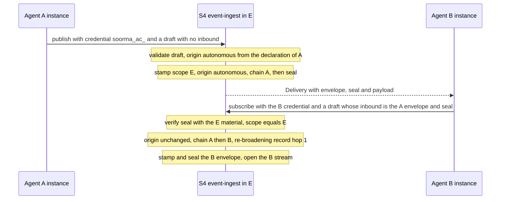

# Business Logic Model: U1 `wire-contract`

**Unit**: U1 `wire-contract` (soorma-core#4)
**Rules**: [business-rules.md](business-rules.md) · **Entities**: [domain-entities.md](domain-entities.md)

U1 has no runtime behaviour of its own. Its logic is the **contract's**: how an envelope
moves across hops, how a request is judged against the contract, how a surface unit adds
an operation, and how a change is classified. U3, U6, and U7 implement the perimeter half.
U1 makes sure the contract says it.

---

## 1. An Envelope Across Two Hops (US-08, US-09)

A publishes in environment E with no inbound context. B, subscribed in E, receives A's
event and then subscribes again, forwarding A's context. Re-broadening is load-bearing at
B's hop (US-09).

### Mermaid diagram

### Text alternative

1. **A drafts**: `clientContractVersion` `0.1.0`, `traceContext`, and no `inbound`. It
   presents its agent credential (`soorma_ac_…`) in `Authorization`
2. **The perimeter judges the request** (Section 2), then stamps the envelope:
   `envelopeVersion` 1; `scope` E (from A's credential); `originMode` `autonomous` (from
   A's registration, which declares autonomy; never from the draft, BR-DR-03);
   `actorChain` `[{agent: A, instance: a1}]`; no `reBroadening`; `traceContext` from the
   draft
3. **The perimeter seals it**: a seal over the JCS form of that envelope, with E's
   sealing material (D-WC-06)
4. **B receives a Delivery**: `{ envelope, seal, payload }`. B keeps any unknown fields it
   does not understand (BR-ENV-05)
5. **B forwards it**: B's next draft carries `inbound: { envelope, seal }`, copied from the
   Delivery. B may re-serialize the envelope; JCS makes the seal survive that
6. **The perimeter verifies** the seal with E's material and checks `scope` = E
   (BR-FC-01, 02). Then it stamps B's envelope: origin `autonomous`, unchanged; chain
   `[A, B]`; `reBroadening` `[{hop: 1}]`, because B's request is allowed only by B's
   declaration; `traceContext` from B's draft; and `inbound`'s unknown fields carried over
   (BR-FC-04)
7. **A later hop C** forwarding B's envelope gets chain `[A, B, C]`. The record
   `{hop: 1}` travels with it, but C does not inherit re-broadening (PF §8b)

**Failures along the way**:

| At step | Failure | Refusal |
|---|---|---|
| 1, 5 | The draft sets `originMode`, `actorChain`, or another stamped field, even alongside an unknown field | `stamped_field_set` |
| 5 | The draft carries a field the contract does not define, and no stamped field | `unknown_field` |
| 6 | The seal fails, comes from E2, or the scope is not E | `invalid_inbound_context` |
| 6 | The chain would reach 33 | `chain_too_deep` |
| 6 | B's envelope, with `inbound`'s unknown fields carried over, would exceed 16 KiB | `envelope_too_large` |
| 5 | B forwards a genuine, sealed envelope from E that it was never delivered, or an old one | **Accepted**: the seal passes. The prefix is true, and authority only narrows (business-rules.md Section 14) |
| 1 | A's registration does not declare autonomy, and there is no `inbound` | `forbidden` (O12) |

---

## 2. How a Request Is Judged Against the Contract

The check order is BR-ERR-07. A request is refused with the first check it fails.

| Step | Check | Refused with | Applies to |
|---|---|---|---|
| 1 | Body size | `payload_too_large` | Every operation |
| 2 | Presentation: one credential, in `Authorization`, of a kind this surface accepts (read from the prefix); no `Soorma-Delegation` | `credential_refused` | Credentialed operations |
| 3 | Verification with this environment's material; then expiry | `credential_refused`, then `credential_expired` | Credentialed operations |
| 4 | Environment matches (O4); revocation state read within the bound (O3) | `credential_refused`; `unavailable` if unreadable | Credentialed operations |
| 5 | Client contract version accepted | `unsupported_contract_version` | Every operation |
| 6 | Schema: on a draft, no stamped field (checked **before** unknown fields, BR-DR-10), then the closed top level | `malformed_request`, `stamped_field_set`, `unknown_field` | Every operation; the draft checks on envelope-bearing ones |
| 7 | Forwarded context: seal, scope, envelope version | `invalid_inbound_context` | Envelope-bearing, with `inbound` |
| 8 | Chain depth | `chain_too_deep` | Envelope-bearing |
| 9 | Origin (O12), then authority (O8, O9) | `forbidden` | Authority-bearing operations |
| 10 | Size of the envelope to be stamped, in JCS form, against 16 KiB. Last, because a re-broadening record is known only after step 9 | `envelope_too_large` | Envelope-bearing |

**Unauthenticated surfaces** (bootstrap, sign-in, first authentication) start at step 5.
The abuse bound is applied before the presented material is verified, and refuses with
`too_many_attempts` whether or not the subject exists (BR-ERR-04).

**Why authentication comes first**: an unauthenticated caller learns nothing about the
draft rules of an operation it cannot use, and the trust checks stay generic (BR-ERR-01).

---

## 3. How a Surface Unit Adds an Operation

U2, U4, U5, U6, and U7 add their operations to `contract/{surface}.openapi.yaml`. Each one
follows these steps, and U1's checks (TC-WC-009 and the build check) enforce them:

1. Reference the shared conventions: Problem, the security schemes, and the
   `Soorma-Contract-Version`, `Soorma-Request-Id`, and `Retry-After` headers. **Never copy
   them**
2. An envelope-bearing operation references the draft (and the Delivery, for a stream)
   from `envelope.schema.json` and `delivery.schema.json` by `$ref`. **Never inline**
   (PF FR-003)
3. Name exactly one accepted security scheme, or none for an unauthenticated surface
   (BR-CR-08)
4. Validate every input: types, lengths, and formats from BR-ID; closed request bodies
   (SECURITY-05)
5. Add any new error code to the open set, documented in the conventions
6. Add a BR-OP row if the operation carries an envelope
7. Classify the change (Section 4), and regenerate the types

---

## 4. How a Contract Change Is Classified

| Change | Envelope v1 | Anything else in the contract |
|---|---|---|
| Add an optional field, a new operation, a new error code, or a new credential kind | Compatible. Ship it | Compatible. Ship it in the current `0.y` line, or the next |
| Widen a value set, or an identifier pattern or length | Compatible, because of BR-ENV-06 and BR-ID-11 | Compatible, because of BR-ID-11 |
| Add a required field; remove, rename, or re-mean a field; change what a credential binds to | **Not in M1** (BR-VER-06; PF FR-004) | Breaking: a new `0.y` version while pre-release |
| Lower `maxChainDepth`, or change the chain's order or minimum length | **Never within envelope v1** (PF §14) | — |

Every change is recorded with its classification. The compatibility test exercises the
previous published schema's fixtures against the current one (I7). Until `contract-v0.1.0`
is tagged, U1's own fixtures are the baseline.

---

## 5. Data Flow Summary

| Data | From | To | Form |
|---|---|---|---|
| Draft | Client | S4 | JSON body, validated against the closed draft schema |
| Credential | Client | S1 to S4 | `Authorization: Bearer`, typed prefix |
| Contract version | Client | S1 to S4 | In the draft, or in the `Soorma-Contract-Version` header |
| Envelope and seal | S4 | Subscriber | In a Delivery on the SSE stream |
| Forwarded envelope and seal | Subscriber | S4 | `inbound` in the next draft, the envelope as received |
| Problem | S1 to S4 | Client | `application/problem+json` |
| Schema and conventions | soorma-core, at a tag | soorma-sdk | Pinned; types generated on each side |
