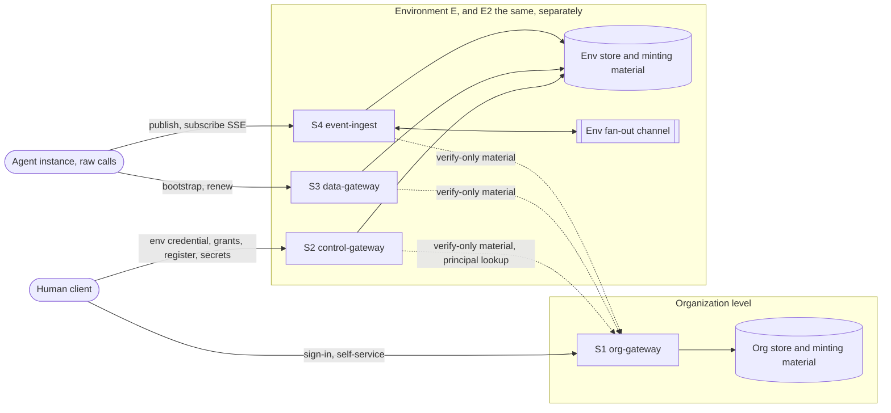

# Component Dependencies: soorma-core M1

## Dependency Matrix

Rows depend on columns. **L** means a linked library, **C** an internal call to another
deployable, and **S** store access.

| | P1 perimeter | P2 envelope | P3 authority | P4 registry | P5 credentials | P6 identity-res. | P7 attribution | P8 abuse-bound | P9 config | P10 org-identity | P11 policy-dec. | Org level (S1) |
|---|---|---|---|---|---|---|---|---|---|---|---|---|
| **S1 org-gateway** | L | — | — | — | — | L | — | L | L | L | — | — |
| **S2 control-gateway** | L | — | L | L | L | — | L | — | L | — | — | C |
| **S3 data-gateway** | L | L (GAP-INT-008) | — | L | L | L | — | L | L | — | — | C |
| **S4 event-ingest** | L | L | L | L | L | — | L | — | L | — | — | C |
| **P3 authority** | — | — | — | L | — | — | — | — | — | — | L | — |
| **P4 registry** | — | — | — | S | — | — | — | — | — | — | — | — |
| **P5 credentials** | — | — | — | — | S | — | — | — | — | — | — | — |
| **P10 org-identity** | — | — | — | — | — | — | — | — | — | S | — | — |

S2, S3, and S4 call the organization level only to fetch verify-only material and, from
S2 alone, `principalExists`. Neither is on a per-request path.

**Layering rules**:
- the edge (S1 to S4) depends on modules, and modules never depend on the edge
- P3 is the **only** module that computes effective authority. P11 answers containment
  for it and is called by nothing else
- P6 and P11 are reached only through their `seams/` interface types
- P10 is linked **only** into S1. Environments reach the organization level through its
  internal interface, never through P10's store

---

## Communication Patterns

| Pattern | Where | Notes |
|---|---|---|
| HTTP with JSON (OpenAPI 3.1) | Callers → S1, S2, S3; publish → S4 | Raw calls need only an HTTP client (PF FR-023) |
| SSE stream (OpenAPI 3.1) | S4 → subscriber | Live only; ends within the propagation bound |
| Internal HTTP, cached | S2, S3, S4 → organization level | Verify-only material; `principalExists` (S2) |
| In-process library calls | S → P modules | Shared code; **no shared trust** (O10) |
| Env fan-out channel | S4 ↔ S4, within E | Internal; no durability (GAP-INT-003) |

---

## Data Flow

### Mermaid diagram



### Text alternative

```text
Human client  --(sign-in, self-service)-------------------->  S1 org-gateway --> Org store
Human client  --(env credential, grants, register, secrets)->  S2 control-gateway --> Env store
Agent (raw)   --(bootstrap, renew)------------------------->  S3 data-gateway --> Env store
Agent (raw)   --(publish; subscribe as SSE)----------------->  S4 event-ingest --> Env store
S4 instances  <-- env fan-out channel (within E only) -->      S4 instances
S2, S3, S4    ..(verify-only material; S2 also principal lookup; cached)..>  S1
Each environment (E, E2) has its own S2, S3, S4, store, minting material, and channel.
Nothing flows between environments.
```

---

## Boundaries Checked

| Constraint | Source | How the dependencies satisfy it |
|---|---|---|
| Revocation store, snapshot resolution, secret verification material, and effective authority are internal | PF §11 | All of them live in P3 to P5 and the env store; no S operation exposes them |
| No entry point trusts another's traffic | O10 | S2, S3, and S4 each link P1 and run their own checks; no service calls another environment service on a request path |
| No credential or minting material crosses environments | PF §6, ID §6, I1 | One deployment, store, and minting material per environment (Q1 A); only verify-only sign-in material is distributed |
| The organization level is on no per-request path | ID FR-009 | Only cached pulls and a control-face lookup |
| Intersection computed in one place | M1-FR-08, I5 | P3 only; P11 answers containment and nothing else |
| The seams decide identity and containment, never authority or composition | PF §12, ID §12 | P6 returns references; P11 returns contained or not; both sit behind `seams/` types |
